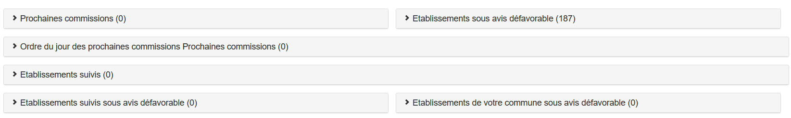
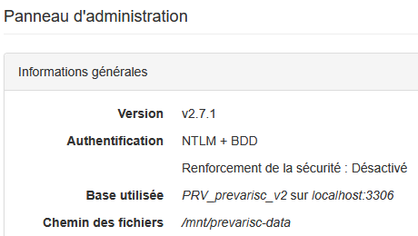
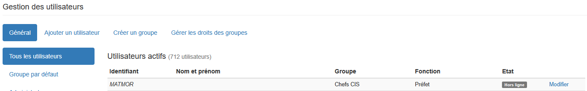
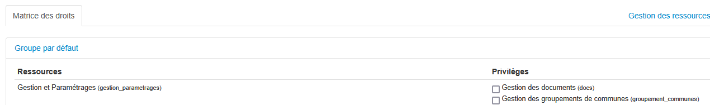

# Guide d'utilisation de Prevarisc

## Table des matières

- [Accueil](#accueil)
- [Administration](#administration)
  - [Informations](#informations)
  - [Gestion des utilisateurs](#gestion-des-utilisateurs)
    - [Général](#general)
    - [Ajouter un utilisateur](#ajouter-un-utilisateur)
    - [Créer un groupe](#créer-un-groupe)
    - [Gérer les droits des groupes](#gérer-les-droits-des-groupes)

## Accueil

La page d'accueil de Prevarisc présente un ensemble de blocs contenant des informations du quotidien.\
\
Chaque bloc peut être déplié via le chevron de gauche, affichant une liste des éléments.\
Une vérification de l'état de Plat'AU est également effectuée afin de vous prévenir de tout dysfonctionnement éventuel.

## Administration

Une zone d'administration est accessible via le bouton "+" de la barre de navigation.\
Cette zone est restreinte aux utilisateurs faisant partie d'un groupe disposant des droits d'accès à l'administration (**cf.** [Gérer les droits des groupes](#gérer-les-droits-des-groupes)). Elle permet aux utilisateurs autorisés de configurer le logiciel dans son ensemble.\
Vous trouverez plus d'informations dans les sous-sections spécifiques.

### Informations

Cet onglet affiche les informations générales du logiciel telles que la version, les éléments techniques comme le mode d'authentification ou le répertoire de stockage des fichiers, et les éléments fonctionnels comme l'activation de plugins ou le choix d'un fournisseur de cartographie.\
\
Est également affichée la liste des utilisateurs actuellement connectés sur l'application.

### Gestion des utilisateurs

Cet onglet permet de gérer les utilisateurs ainsi que les groupes et les droits associés.

#### Général

Cet onglet affiche par défaut la liste de tous les utilisateurs, avec un filtre possible pour chaque groupe. Les utilisateurs sont catégorisés en fonction de leur statut d'activité : actif ou inactif.\
\
Depuis cette liste, il est possible de modifier un utilisateur via l'action correspondante.\
Si un filtre sur un groupe est appliqué, il est également possible de modifier ou supprimer le groupe concerné. Lors de la suppression d'un groupe, les utilisateurs associés seront affectés au groupe "Groupe par défaut".\
**Note :** Il est impossible de supprimer le groupe "Groupe par défaut".

#### Ajouter un utilisateur

Cet onglet permet la création d'un utilisateur. De nombreuses informations peuvent être renseignées mais elles sont toutes optionnelles, hormis le **login** et le **mot de passe** (si le mode d'authentification est interne à l'application et non via un SSO).

#### Créer un groupe

Cet onglet permet la création d'un groupe. La description est optionnelle.\
**Note :** Par défaut, un groupe ne dispose d'aucun droit.

#### Gérer les droits des groupes

Cet onglet permet d'affecter des droits (privilèges) à un groupe. De nombreux droits sont disponibles et sont catégorisés en "Ressources" pour aider à l'identification de la section de l'application concernée.\
\
Un onglet "Gestion des ressources spécialisées" permet une gestion plus fine de certains droits. Ainsi cet onglet permet par exemple de donner à un groupe les droits en lecture uniquement pour les établissements de type CTS et de 5ème catégorie.\
En plus de ces critères, il est également possible de filtrer sur les commissions, groupements et commune associés à l'utilisateur.